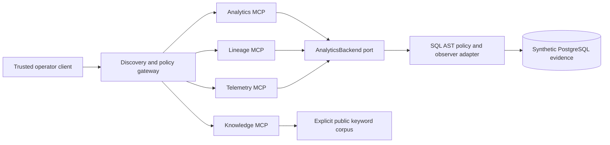

# Analytics backends and authorized MCP infrastructure

This milestone adds read-only database diagnostics and nine typed business tools across
four official Python MCP SDK servers. It does not add investigation agents, hypothesis
orchestration, graph memory, vector retrieval or a remote HTTP authorization service.

## Local quick start

From the repository root, after creating `.env` with local infrastructure credentials:

```sh
make setup
make infra-up
make sim-bootstrap
make sim-migrate
# Fresh fixture only: make sim-generate
# For an existing fixture, make sim-reset restores its baseline.
make mcp-demo
make check
make test-all
make mcp-integration
```

`mcp-demo` launches four stdio subprocesses, initializes MCP sessions, discovers all
nine tools, registers them in a gateway and invokes each against the synthetic dataset.
It prints correlated structured responses. The trusted operator client reads only the
observer URL from local `.env`, generates a fresh session token and explicitly grants
read permissions. Child processes receive that token, permission list and observer URL;
they never read `.env` and are not given the simulator owner URL or evaluator directory.
The knowledge server receives no database credentials. Public documents are packaged
with the server; they contain contracts/operations guidance, not benchmark answers.

This client is an operator demonstration, not an authorization service for untrusted
users. Do not allow an agent to launch it or change subprocess permission configuration.
Future control-plane code must authenticate callers and provision scoped principals.

## Storage-neutral protocol

`atlas_core.analytics.AnalyticsBackend` defines async operations with shared Pydantic
contracts, independent of PostgreSQL/Teradata implementations:

| Method | PostgreSQL | Teradata |
|---|---|---|
| execute_readonly_query | Implemented and live tested | Official driver path, live unverified |
| get_schema | Implemented and live tested | Explicit allowlist + ColumnsV path, live unverified |
| get_table_metadata | Columns, primary key, indexes; live tested | ColumnsV fields only; live unverified |
| get_column_statistics | Count/null/distinct/min/max and numeric mean; live tested | Count/null/distinct/min/max path; live unverified |
| get_query_plan | EXPLAIN FORMAT JSON, ANALYZE FALSE; live tested | EXPLAIN path, live unverified |
| get_table_dependencies | Foreign-key catalog edges; live tested | Explicit unsupported_capability |
| get_supported_capabilities | Runtime success tracked per operation | All live_verified flags remain false |

Metadata fields unavailable on an adapter are null, rather than fake empty results.
Profiling explicitly rejects unsupported types. Decimal results serialize as strings,
dates/timestamps and UUIDs as strings, binary values as hex. Results include columns,
rows, count and a truncation indicator. Query plans never enable ANALYZE.
Table dependencies represent foreign keys; the separate lineage tools represent
transformation flow. No investigation layer imports vendor drivers.

## PostgreSQL safety boundary

The adapter uses asynchronous psycopg connections and requires an explicit catalog
allowlist. The local default contains the simulator's 28 business/metadata evidence
tables, excluding outbox, inbox and evaluator files. It verifies at execution time:

- The login is not superuser, role/database creator, replication user or RLS bypasser.
- It has no schema CREATE or server-file/program role membership.
- Every approved relation exists as an ordinary base table, grants SELECT and grants
  none of INSERT/UPDATE/DELETE/TRUNCATE/REFERENCES/TRIGGER.

Each transaction is explicitly READ ONLY, fixes search_path to pg_catalog, sets a
statement timeout and bounded lock timeout, then closes its connection. Physical
source tables are schema-qualified after AST validation. The provided bootstrap's
atlas_observer account satisfies this policy; owner/admin credentials are rejected.
The adapter currently rejects views, foreign tables and partitioned parents rather
than claiming their transitive behavior has been reviewed. Configure a separate
SELECT-only login and approved catalog for other data sources.

SQLGlot parses the specified PostgreSQL or Teradata dialect. Policy admits a reviewed
AST subset, not arbitrary SELECT-shaped text. It rejects unknown nodes/functions,
DML/DDL inside CTEs, multiple statements, locks, SELECT INTO, recursive CTEs, external
catalogs, system/private tables, table functions and dangerous casts. Scope analysis
distinguishes CTE aliases from physical table access. Unreviewed valid SQL may therefore
be denied; extend the subset only with security tests.

Named `:parameter` markers must exactly match scalar bindings. The PostgreSQL adapter
uses native psycopg bindings, including careful literal-percent handling; Teradata
receives generated positional `?` markers and values in generated SQL order. Identifiers
are resolved from authorized metadata and quoted independently, never value-interpolated.

Limits: SQL text 16,000 characters, AST 800 nodes, request bindings 100, requested rows
1–1,000, statement timeout 10–30,000 milliseconds. The adapter applies an outer result
limit of requested rows plus one, respects a smaller literal SQL limit and fetches at
most that amount. Replies are capped at one megabyte after encoding. Metadata cannot silently truncate: ordinary PostgreSQL tables
up to 1600 columns are supported; oversized index/dependency catalogs fail explicitly. Large individual
database cells are decoded before that final size check; this is not a streaming byte
quota. Connect timeout and statement timeout are distinct; the gateway supplies the
end-to-end deadline. Connection cancellation/cleanup retains the local concurrency slot.

## Teradata: implemented versus unverified

Install the optional official driver:

```sh
uv sync --locked --extra teradata
```

`TeradataAnalyticsBackend(host, user, SecretStr(password), database, tables,
readonly_role_attested=True)` uses official `teradatasql`, ANSI sessions, named-to-positional
binding, TOP row bounds, bounded fetch, request_timeout, connect_timeout, logon_timeout,
VERIFY-FULL TLS and encrypted-data options,
and cancellation/close cleanup. Operator-controlled connection settings disable STARTUP
SQL. The driver is blocking, so work runs in a worker thread with cancellation coordination.
The driver request timeout rounds up to whole seconds; the MCP deadline remains separate.

Execution refuses to start unless an administrator explicitly attests that the account
is SELECT-only. This is an out-of-band attestation, **not verified effective-role
inspection**. The adapter does not create or validate Teradata grants. Provision a
login with SELECT on approved datasets and the required dictionary views, with no DML,
DDL, procedure execution, administrative or inherited write grants. No Vantage endpoint
or credentials were available during this phase, so connectivity, effective privileges,
dictionary compatibility, cancellation and timeout behavior remain live unverified.

Query, ColumnsV metadata, aggregate profiling and EXPLAIN driver paths are implemented.
Primary keys/indexes/numeric mean and dependency-catalog mapping are not implemented
for Teradata. Dependency lookup returns a structured unsupported error. Unit tests use
a driver double to check binding/options/cleanup and cannot establish live compatibility.
The local MCP composition uses PostgreSQL; a Teradata-backed composition must be
explicitly provisioned and validated before deployment. No fake successful integration
or fallback synthetic Teradata results are returned.

Official references: [Teradata Python driver](https://github.com/Teradata/python-driver),
[SQLGlot](https://github.com/tobymao/sqlglot), and the
[official MCP Python SDK](https://github.com/modelcontextprotocol/python-sdk).

## Servers, schemas and permissions

| Server command | Tool | Required application permission |
|---|---|---|
| atlas-mcp analytics | get_table_schema | analytics:schema |
| atlas-mcp analytics | execute_readonly_sql | analytics:query |
| atlas-mcp analytics | profile_column | analytics:profile |
| atlas-mcp analytics | get_query_plan | analytics:plan |
| atlas-mcp lineage | trace_upstream_lineage | lineage:read |
| atlas-mcp lineage | trace_downstream_lineage | lineage:read |
| atlas-mcp telemetry | get_pipeline_execution | telemetry:read |
| atlas-mcp telemetry | search_incident_history | telemetry:read |
| atlas-mcp knowledge | search_technical_documents | knowledge:read |

Every tool has a Pydantic input and output contract and published JSON Schema.
`schemas/mcp/*-v1.json` records all descriptors, schemas and explicit permissions;
`make mcp-schemas` regenerates them without contacting a database.

Arguments contain a required application context:

```json
{
  "context": {
    "investigation_id": "72c5584b-f456-4000-b235-612b11757022",
    "request_id": "604df4fb-a4c4-403d-8d4d-9c4e724b05df",
    "timeout_ms": 5000
  },
  "query": {
    "sql": "SELECT id FROM orders WHERE currency = :currency",
    "parameters": {"currency": "USD"},
    "row_limit": 10,
    "timeout_ms": 3000
  }
}
```

The session token is sent separately in MCP request `_meta.atlas_token`, never tool
arguments. MCP itself does not authenticate or authorize this application. An
`Authorizer` compares token digests and derives a trusted configured principal; the
caller cannot supply or escalate permissions through tool arguments. Default server
permissions are empty. Tool annotations are descriptive hints, not policy grants.

For standalone sessions, the trusted launcher provisions ATLAS_MCP_ACCESS_TOKEN
(at least 32 characters), ATLAS_MCP_PERMISSIONS (JSON array), ATLAS_MCP_PRINCIPAL,
ATLAS_MCP_READER_URL (except knowledge), and optionally ATLAS_MCP_AUDIT_DIR,
ATLAS_MCP_ALLOWED_TABLES and ATLAS_MCP_BUDGET (JSON object). These variables are
intentionally not loaded from `.env` by child servers. Keep tokens outside logs and
shell history. Use the working Python client/transports module as the launcher example.

Replies contain status, investigation_id, request_id, trace_id, typed result and
structured error (code/message/retryable). Success requires a result and investigation
ID; failure requires an error and no result. SQL text, bound values, tokens, driver
exception details and validation payloads are not reflected in errors or audit records.
The SDK's low-level dispatcher routes invalid tool inputs through our validator so
those rejections are also audited. A malformed/missing context receives a generated
request/trace ID and a null investigation ID; no business tool executes. Malformed
JSON-RPC frames rejected by the SDK are protocol errors, not executed tool calls.

Lineage uses persisted column edges, bounded breadth-first traversal, cycle detection,
depth at most 10, at most 100 visited nodes and 300 returned edges. It reports truncation
if the source edge scan or traversal cap limits the answer. Telemetry reads actual
pipeline runs and operational events through bound read-only queries. Incident search
treats user wildcard characters literally. Knowledge retrieval performs real deterministic
keyword matching over three explicit public documents. No vector, RAG or graph retrieval
is claimed, and no recursive filesystem search is performed.

## Gateway, transport and lifecycle




`Gateway` registers validated tool schemas and can discover tools through a typed
`ToolTransport` interface. Discovery accepts only operator-approved tool names and an
explicit permission mapping; a server cannot assign itself permissions through metadata.
Duplicate registrations, external schema references, altered schema resolution scopes
and oversized schemas are rejected. Forwarded responses must match the discovered
schema and application request/investigation correlation IDs.

`SessionTransport` wraps the official SDK ClientSession. `local_transport` manages
stdio initialization and session/process cleanup. The gateway checks application auth,
permissions, input/output schemas, size limits, deadlines, budgets and concurrency.
Direct calls to an individual server still encounter its own gateway, so bypassing
the demonstration client's gateway does not bypass server policy.

A remote transport can implement ToolTransport or wrap an independently authenticated
SDK session. Remote HTTP/TLS/OAuth provisioning is **not implemented or tested** here;
endpoint identity, server authorization and credential forwarding must be explicitly
configured before adding such a transport. There is no automatic network fallback.

Budgets default to 50 accepted calls, 120,000 cumulative/reserved milliseconds and
10,000 result rows per principal/investigation per gateway ledger; concurrency defaults
to four. Reservations occur under a file lock before work starts and persist across
restarts. In-flight requests reserve their worst-case time and row allowance; completion
charges actual measured time/rows. Reused request IDs are rejected within that scope.
In-flight reservations remain charged at worst-case cost after a crash. Slots remain
reserved while their owner process lives, even after the deadline while work cleans up.
Dead owner slots can be reclaimed; PID reuse and legacy unfinished records conservatively
require operator recovery. Audit lock contention fails closed after a bounded wait.
The local semaphore holds a slot until cancellation cleanup completes. Invocation deadlines include preparation and queueing; expired work cannot start or report success.
Final audit/native cleanup may extend the response deadline. Gateway and child-server ledgers are separate,
so each hop enforces its own budgets; these are not cluster-wide quotas.

Investigation ownership/admission is a future control-plane responsibility: callers
must not be allowed to create unlimited new investigation IDs to evade per-investigation
budgets. Local tokens are session capabilities, not a multi-user identity provider.
The current stdio operator client is the tested trust boundary.

Every accepted call writes durable started/finished trace records; denials and invalid
inputs write rejection records. Records include principal, tool, investigation/request/
trace IDs, input/result hashes, timestamps, elapsed time, result count and safe error
code. They omit SQL, values, credentials and result bodies. Unknown tool names are hashed, and
remote errors use safe messages and allowlisted codes. Files are mode 0600 in a
mode-0700 `.atlas-runtime` directory and use locks/fsync. Audit failures prevent successful
responses. The append-only JSON ledger is capped at 20 MB and fails closed when rotation
is needed. Do not casually delete it: it also backs replay protection and budget state.
A shared durable budget/audit service and operational retention policy are future work;
no database schema changes or Alembic migration were necessary for this file-based ledger.

EOF/disconnection exits each server through gateway.close; in-flight work is cancelled
and awaited. SDK transport contexts close/reap child processes. Audit completion runs
during cancellation cleanup. Tests cover this lifecycle, including denial after close.

## Verification and remaining boundaries

```sh
make check
make test-all
make mcp-integration
make mcp-demo
make mcp-schemas
uv build
```

The normal suite covers SQL AST attacks in both dialects, CTE scoping, binding, token
and permission failures, input errors, budget persistence, concurrency/cancellation,
audit failure, remote schema/correlation checks, corpus isolation, schema exports and
real SDK stdio lifecycle. Live tests exercise PostgreSQL metadata/statistics/plans/FKs,
privileged-role rejection, injection resistance, row/byte bounds, actual statement
timeouts, recovery and all nine tools over the four subprocess servers. Existing
simulator fault/reset/replay and Kafka integration tests remain part of the live suite.
Teradata tests are driver-wiring tests only; no live Vantage result is asserted.

The next boundary is investigation control-plane admission and durable execution
using these typed analytics and tool interfaces. Do not add agents, RAG or graph-memory
implementations without a new authorized milestone. Preserve the separation between
public evidence access, execution/audit state and evaluator ground truth.

For the skeptical review, confirmed fixes and requirement matrix, see
[database/MCP audit](reviews/database-mcp-audit.md). To reproduce clean-source setup
with an automatically cleaned-up PostgreSQL container:

```sh
uv run --locked python scripts/verify_clean_mcp_setup.py
```
