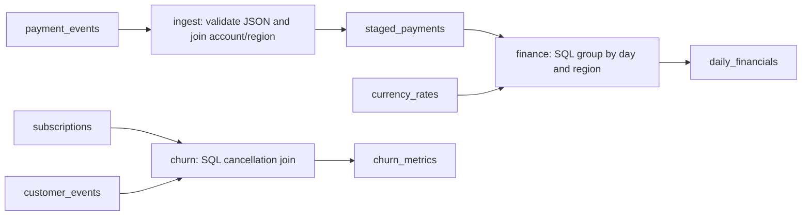

# Enterprise simulator and fault-injection engine

Aurora Commerce is a fictional multinational retail/subscription company operating
in North America, continental Europe, the UK and Japan. No real customer data or LLM
is used. All source generation uses a local seeded PRNG, decimal money, deterministic
business IDs and a fixed simulated calendar. CLI commands are evaluator/operator
commands that mutate synthetic fixtures; they must never be registered as agent tools.

## Run locally

From the repository root with Python 3.12, uv, Docker and Compose installed:

```sh
make setup
# On a fresh checkout: cp .env.example .env
# Set independent POSTGRES_PASSWORD and NEO4J_PASSWORD values in .env.
make infra-up
make sim-bootstrap
make sim-migrate
make sim-generate
```

Bootstrap creates a dedicated `atlas_simulator` PostgreSQL database and `atlas_observer`
login. It writes connection URLs and the generated observer password to the ignored,
mode-0600 `.env`; it never prints credentials. Re-running bootstrap reuses existing
settings. Migrate runs Alembic and applies explicit SELECT grants. The control-plane
API does not connect to this database and remains unchanged.

`generate` refuses an existing registry or populated fixture database. Use `reset`
for the current fixture, or a different dedicated database and private directory for
another profile/configuration. Never point these commands at a production database.
Bootstrap intentionally configures the local Compose instance, not remote infrastructure.

```sh
uv run --locked atlas-sim generate --profile medium --seed 77
uv run --locked atlas-sim generate --config path/to/generation.json
```

The alternatives above each require an empty migrated database/private directory.
GenerationConfig JSON supports `seed`, ISO `start`, `days`, `customers`,
`orders_per_day`, and `late_probability`. Default start is 2025-11-01. Supported ranges
are enforced by Pydantic; scenario/fault windows must fit the fixture.

| Profile | Customers | Days | Nominal orders/day |
|---|---:|---:|---:|
| small | 80 | 28 | 18 |
| medium | 800 | 90 | 80 |
| large | 6,000 | 365 | 300 |

Nominal orders are modulated by weekends, annual seasonality and seeded daily noise.
Regions differ in purchase weights, currencies, prices and churn probability; product
weights and quantities differ. Monthly renewal payments stop at cancellation; signup
and cancellation events explain the subscription state. Inventory decreases with
orders in the regional warehouse. Marketing touches reference campaigns, accounts and
orders. Support tickets reference accounts. A small share of events arrives 1–3 days
late; the end-of-fixture watermark leaves the latest arrivals unreported. Historical
payload v1/v2 metadata models an optional processor field addition.

Generation constructs a dataset in memory and loads it in 1,000-row batches. All three source profiles were exercised (large: 785,024 generated rows). Full medium/large
database loading and enterprise workload performance have not been benchmarked. Large
profiles are supported configurations, not a claim of streaming-scale generation. Use fixed code/dependency versions with the config
to reproduce a benchmark; algorithm changes require a new benchmark version.

See the [complete 30-table model](simulator-data-model.md) for fields and foreign keys.

## Executable pipelines and lineage



The persisted DAG has a real `finance -> ingest` dependency. A topological sort rejects
cycles before execution. Definitions select known, versioned transformation code;
there is no arbitrary/generated SQL execution. Ingestion parses actual JSON payment
payloads, applies the reporting watermark and joins payment/account/customer records.
Financial reporting executes a grouped SQL join to daily exchange rates. Churn executes
SQL joins between subscriptions and cancellation events, with active denominators.

Pipelines persist source/destination dataset IDs, transformation definition, schema
contract, dependencies and runs with simulated start/end times, input/output counts,
quality metrics and status. Reverse dependency edges identify downstream consumers.
Distinct source/destination pairs in `column_lineage` supply table lineage including
lookup inputs; individual rows supply source/destination column expressions.
The catalog describes all 20 business datasets. Generated `id` and `created_at` fields
are technical fields rather than business-derived column lineage.

Payment quality checks measure invalid payloads, events beyond the watermark, repeated
business keys and absent partition days. Financial quality checks detect unmatched
currencies and day-to-day FX changes exceeding 25%. Churn quality records impossible
counts above active subscribers. These checks are observable symptoms, not oracle labels.
Unexpected transformation errors roll back the operation; the private pending record
signals that an evaluator reset is required. This milestone does not implement a
background scheduler, retry worker or durable failed-task system.

## Inject, reset and replay

Example configurations for all six faults are in `evaluation/faults/`.

```sh
uv run --locked atlas-sim inject --config evaluation/faults/missing_partitions.json
uv run --locked atlas-sim ground-truth
uv run --locked atlas-sim reset
# Use a fault_id returned by inject or ground-truth:
uv run --locked atlas-sim replay <fault-id>
uv run --locked atlas-sim reset
```

| Fault | Actual mutation | Measurable impact |
|---|---|---|
| schema_drift | Rename raw JSON amount to gross_amount and record schema v3 | Rejected ingestion rows and lower reported revenue |
| delayed_ingestion | Move arrival timestamps forward | Events cross the watermark and disappear from the report |
| duplicate_transactions | Append copies with unique physical IDs but repeated business keys | Higher payment volume/revenue and duplicate alerts |
| incorrect_join | Join cancellations to subscriptions by region for the selected window | Churn assigned to unrelated subscriptions |
| missing_partitions | Delete raw events in selected date partitions | Missing days and lower reported revenue |
| currency_conversion | Multiply selected daily FX rates | Changed converted revenue and possible FX jump alerts |

Every fault accepts `kind`, `day` and `duration_days`. Duplicate faults additionally
use `copies`; delays use `delay_days`; currency faults use `currency` and
`rate_multiplier`. Delays only affect reports when arrivals cross the configured
watermark; a multiplier of 1 intentionally has no financial effect. A join window
without cancellations has no churn effect. Checked-in benchmark configurations avoid
these no-op settings. Only one active fault is allowed to preserve single-cause ground
truth. Fault IDs are deterministic UUIDs derived from fixture configuration and fault
configuration; operator execution IDs are fresh on each run.

The registry records configuration, UTC wall-clock injection timestamps, baseline and
affected metrics, known root cause and execution IDs. Public event times/pipeline
times are simulated calendar values, distinct from the wall-clock injection timestamp.
Reset deterministically regenerates all source/derived/catalog tables, while retaining
the private fault history and durable public outbox/inbox. Per-fixture pipeline run
rows are rebuilt; historical execution envelopes remain in the outbox. Replay resets
then reapplies the recorded configuration under one exclusive evaluator lock.

Private writes use atomic rename and restrictive permissions. Registry intent is
persisted before mutation; interruptions can leave `pending` state. Run `reset` to
recover, then `replay`. Registry and PostgreSQL do not share a distributed transaction.
Use one private directory and one operator writer per fixture database; file locks
coordinate users of that directory, not unrelated machines.

## Benchmark scenarios

```sh
uv run --locked atlas-sim scenario evaluation/scenarios/a_missing_partitions.json
uv run --locked atlas-sim scenario evaluation/scenarios/b_incorrect_join.json
uv run --locked atlas-sim scenario evaluation/scenarios/c_duplicate_events.json
uv run --locked atlas-sim reset
```

Each scenario establishes/reuses the identical seed-42 small baseline, resets prior
faults, injects its configuration, checks the expected metric direction and prints
results. A differing existing fixture configuration is rejected. JSON definitions
record actual affected datasets and expected evidence. Root causes reside in the
private registry; reset is the procedure above.

Observed PostgreSQL results for the shipped scenarios:

| Scenario | Baseline | After injection |
|---|---:|---:|
| A: revenue USD | 49,557.96 | 45,009.98 |
| B: churned subscriptions summed across daily reports | 16 | 280 |
| C: captured payment-event count | 681 | 737 |

Expected evidence includes partition gaps while payment ledger rows remain present,
changed join definitions with unchanged cancellation sources, and duplicate business
keys while payment ledger counts remain unchanged. Tests check the actual affected
datasets and metric deltas rather than accepting the evaluator's label as proof.

## Kafka and idempotency

```sh
uv run --locked atlas-sim publish
uv run --locked atlas-sim consume --group atlas-observations --max-messages 10000
uv run --locked atlas-sim publish --replay
uv run --locked atlas-sim consume --group atlas-observations --max-messages 10000
```

Configure `ATLAS_SIM_KAFKA_BOOTSTRAP` and `ATLAS_SIM_KAFKA_TOPIC` in `.env` if needed.
The local broker supports topic auto-creation. Production topic administration is not
part of this milestone. The consumer stops at its maximum or after an idle poll.

The public discriminated union has four version-1 event types: pipeline execution,
schema change, quality alert and operational telemetry. JSON Schema is checked in at
`schemas/events/simulator-v1.json`; regenerate with `atlas-sim schemas`. Unsupported
versions, unknown event types and extra fields are rejected.

Data changes and outbox writes commit together. Publishing waits for broker delivery
acknowledgements before marking an envelope published; failures leave it retryable.
The broker producer uses idempotence and all acknowledgements. Publication is still
at least once across process crashes or competing publishers. Replay resends unchanged
envelopes with unchanged event IDs. There is no global ordering guarantee across
fixture executions; use run IDs and occurrence timestamps to reconstruct a run.

Consumers disable automatic offset commits, validate envelopes, insert unique
(group,event_id) receipts and apply an optional handler within the same database
transaction. Kafka offsets commit only after that transaction. Replays do not repeat
committed effects; handler failures roll back receipts. External side effects require
their own idempotency mechanism. The supplied CLI persists observations as its effect.

## Ground-truth access boundary

`.atlas-private/ground_truth.json` is evaluator-only, with directory mode 0700 and file
mode 0600. No oracle table exists in PostgreSQL, and no ground-truth ID, label, expected
cause or private registry content is sent to Kafka or exposed by FastAPI. Investigation
runtimes must receive only the observer URL and public telemetry, never `.env`, this
private directory, evaluator scenario files, or the evaluator operator CLI.

The observer is non-superuser, has no role-management/database-creation capability,
can SELECT only explicit evidence tables, and cannot modify tables, read outbox/inbox,
create tables or call PostgreSQL server-file reading functions. Isolation tests verify
these database permissions. This is not a sandbox against code running as the evaluator's
OS user: future agent containers must use a different identity and omit private mounts.
No investigation runtime exists yet, so that deployment boundary remains future work.

## Verification

```sh
make format
make check
make sim-integration
uv run --locked alembic check
```

The ordinary test suite uses migrated SQLite databases with foreign keys and explicit
transaction boundaries. Real integrations use temporary PostgreSQL schemas and a
temporary Kafka topic, removed afterward. They test all six faults, schema agreement,
reset/replay, broker delivery/replay and observer permissions. Default tests skip live
integrations unless explicit environment variables are set. `sim-integration` loads
local private settings into a subprocess without shell-expanding credentials.

References: [Alembic tutorial](https://alembic.sqlalchemy.org/en/latest/tutorial.html)
and [Confluent Python client](https://docs.confluent.io/kafka-clients/python/current/overview.html).

## Next integration boundary

A future read-only database adapter can expose business datasets, schema history,
lineage, pipeline runs and operational evidence through typed ports. A separate
telemetry consumer can project the versioned public events using the transactional
inbox handler. The evaluator alone compares investigation reports with the private
registry. SQL policy enforcement, MCP business tools, agent orchestration and causal
scoring are not implemented by this milestone.
